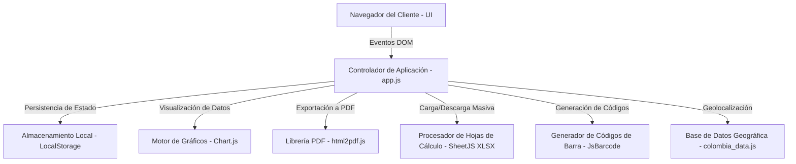
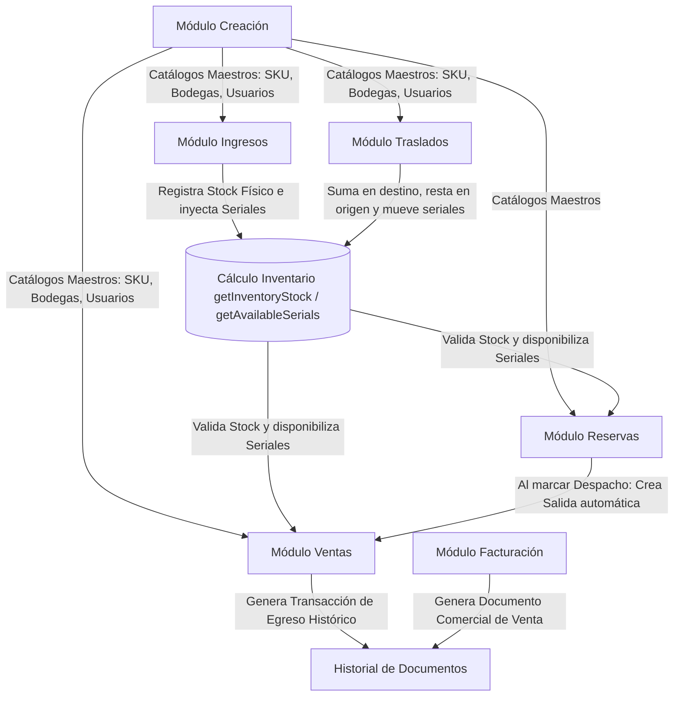
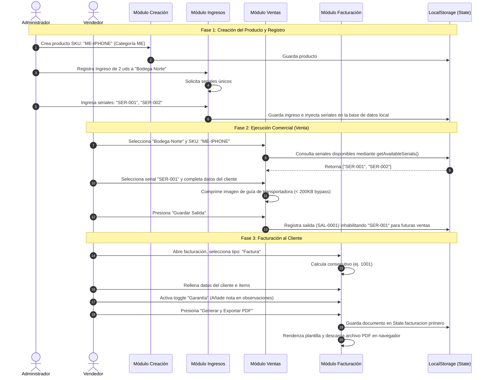

# Documentación Técnica Oficial - Sistema Inventario 360°

## 1. Introducción del Proyecto

El **Sistema Inventario 360°** es una aplicación web del lado del cliente (*Single-Page Application* o SPA) diseñada para administrar de forma integral el inventario físico, los despachos comerciales, la facturación comercial/cotizaciones, la gestión de garantías de productos de categoría especial, y las reservas prepagadas. El sistema opera de manera autónoma en el navegador web del usuario y utiliza una arquitectura distribuida basada en el almacenamiento local (*LocalStorage*) para persistir la información de manera segura y sin dependencias inmediatas de un servidor de backend tradicional.

---

## 2. Objetivo General

Proporcionar una plataforma unificada, rápida y visualmente atractiva que automatice y centralice el control físico de inventario por bodegas, el seguimiento individual de productos por número de serial único (Categoría ME), la generación dinámica de documentos comerciales en formato PDF, y la emisión de rótulos de envío estandarizados, garantizando la consistencia lógica de las existencias en tiempo real y asegurando el control de accesos basado en roles.

---

## 3. Alcance del Sistema

El sistema cubre la gestión logística, administrativa y comercial a través de los siguientes límites funcionales:
*   **Gestión Logística Completa**: Registro de entradas (ingresos), salidas (egresos) y traslados de mercancía entre múltiples bodegas físicas, con soporte para productos regulares (Categoría T&M / Accesorios) y productos serializados con control individual de números de serie (Categoría ME).
*   **Control de Garantías**: Registro estructurado de novedades y fallas de fábrica por piezas asociadas a productos ME, incluyendo la carga opcional de soportes físicos comprimidos (imágenes/PDF).
*   **Gestión Comercial**: Emisión y descarga en PDF de Cotizaciones, Pre-Facturas y Facturas con consecutivos autoincrementales a partir del número 1001, cálculo de impuestos, descuentos y notas de garantía integradas de forma condicional.
*   **Reservas**: Registro de abonos por productos apartados, almacenamiento de soportes de pago y módulo de despacho automatizado que sincroniza el egreso físico una vez que el cliente liquida el saldo restante.
*   **Rótulos de Envío**: Generación e impresión de guías físicas y etiquetas de despacho para transportadoras a partir de plantillas integradas.
*   **Seguridad**: Control de accesos jerárquicos a través de 4 perfiles de usuarios (Administrador, Ventas, Visualización y Personalizado).

---

## 4. Arquitectura General del Sistema

El sistema utiliza una arquitectura **SPA (Single-Page Application) basada en el Cliente**, lo que elimina el viaje de ida y vuelta al servidor para renderizar interfaces.



### Flujo de Datos e Integración de Persistencia
El estado de la aplicación se centraliza en un único objeto global `State` definido en `app.js`. Cada cambio provocado por transacciones de formularios se escribe en memoria y se serializa inmediatamente a JSON en la clave de almacenamiento local `inv360_state`. Al iniciar la aplicación, el sistema lee y parsea este objeto para restaurar el entorno operativo del usuario.

---

## 5. Tecnologías Utilizadas

*   **Frontend Core**: HTML5 (Marcado semántico), CSS3 Vanilla (Diseño adaptativo, variables de diseño, glassmorphic UI, animaciones de micro-transiciones).
*   **Lógica de Negocio**: JavaScript ES6+ (Manipulación avanzada del DOM, programación asíncrona, Canvas API para compresión).
*   **Librerías Externas (Vía CDN)**:
    *   [Lucide Icons](https://lucide.dev/): Biblioteca de iconos vectoriales interactivos.
    *   [Chart.js (v4.x)](https://www.chartjs.org/): Generación dinámica de gráficos analíticos de ventas y rendimiento en el Dashboard.
    *   [SheetJS / XLSX (v0.18.5)](https://sheetjs.com/): Motor de lectura, escritura y parseo de archivos de hojas de cálculo de Microsoft Excel.
    *   [html2pdf.js (v0.10.1)](https://rawgit.com/eKoopmans/html2pdf.js/master/dist/html2pdf.bundle.min.js): Conversor de plantillas HTML a documentos vectoriales PDF.
    *   [JsBarcode (v3.11.5)](https://lindell.me/JsBarcode/): Generación de códigos de barra lineales en los rótulos y plantillas de impresión.

---

## 6. Estructura del Proyecto

El código fuente está organizado en una estructura plana y optimizada para la carga directa en navegador:

*   [index.html](file:///c:/Users/Falcon/Documents/Sistema%20Inventario/index.html): Documento principal que define la estructura del DOM, modales de acción, contenedores de los 10 módulos y referencias a dependencias CDN.
*   [styles.css](file:///c:/Users/Falcon/Documents/Sistema%20Inventario/styles.css): Hoja de estilos que implementa el sistema de diseño en modo oscuro, variables CSS, clases de utilidad y reglas de diseño responsivo.
*   [app.js](file:///c:/Users/Falcon/Documents/Sistema%20Inventario/app.js): Núcleo de la lógica del sistema. Define la inicialización del estado (`State`), manejadores de eventos, validaciones de formularios, algoritmos de cálculo de inventario y generación de reportes.
*   [colombia_data.js](file:///c:/Users/Falcon/Documents/Sistema%20Inventario/colombia_data.js): Archivo de datos estático que define el mapa de Departamentos y Municipios oficiales de Colombia.
*   [rotulo_templates.js](file:///c:/Users/Falcon/Documents/Sistema%20Inventario/rotulo_templates.js): Almacena las plantillas vectoriales codificadas en Base64 para el módulo de rótulos.

---

## 7. Descripción Detallada de los Módulos

El sistema está compuesto por 10 módulos interconectados de forma lógica. A continuación se describe en detalle cada uno de ellos.

---

### Módulo 1: Inicio de Sesión y Control de Acceso (Login)

*   **Objetivo**: Controlar el ingreso de los usuarios autorizados y denegar accesos no autorizados mediante credenciales cifradas y control de jerarquías.
*   **Funcionalidad Principal**: Autenticación de usuarios por nombre de usuario o correo electrónico y contraseña. Proporciona la opción "Olvidé mi contraseña" para reestablecer credenciales mediante una clave maestra o de emergencia.
*   **Responsabilidades**:
    *   Validar credenciales contra el listado de usuarios activos en `State.users`.
    *   Establecer la variable de sesión activa `State.activeUser`.
    *   Cargar permisos específicos del usuario mediante `applyRolePermissions()`.
*   **Interfaces**: Pantalla completa de login con fondo degradado y tarjetas de diseño limpio. Incluye modales flotantes para la recuperación de contraseñas.
*   **Flujo de Trabajo**:
    ```mermaid
    graph TD
        A[Usuario ingresa credenciales] --> B{¿Es primer ingreso del Admin?}
        B -->|Sí| C[Modal: Crear contraseña Admin]
        B -->|No| D{¿Credenciales correctas?}
        D -->|Sí| E[Establecer ActiveUser y cargar showApp]
        D -->|No| F[Mostrar bloque de error por 4 segundos]
    ```
*   **Reglas de Negocio**:
    *   Si es la primera vez que se accede y el Administrador no tiene contraseña asignada (`inv360_admin_password_set` es falso), el sistema fuerza la asignación de una nueva contraseña en el primer login.
    *   El campo de correo electrónico no distingue entre mayúsculas y minúsculas durante la búsqueda.
    *   La clave de emergencia o maestra permite reestablecer cualquier contraseña directamente desde la pantalla de login.
*   **Datos que recibe**: Username/Email, Password, Clave maestra de recuperación.
*   **Datos que genera**: Objeto de sesión activa en `LocalStorage`.
*   **Base de datos involucrada**: `State.users` y `State.activeUser`.
*   **APIs o servicios utilizados**: Ninguno.
*   **Dependencias con otros módulos**: Afecta directamente la visibilidad de los menús en la barra lateral de todos los demás módulos.

---

### Módulo 2: Dashboard Analítico

*   **Objetivo**: Ofrecer una vista analítica y consolidada del estado del inventario, ventas, metas y alertas de rotura de stock.
*   **Funcionalidad Principal**: Renderizado de KPIs cuantitativos (Valor total del inventario, unidades en stock, alertas de stock mínimo) y gráficos interactivos de ventas por vendedor, canal de ventas y productos más vendidos.
*   **Responsabilidades**:
    *   Calcular el stock global consolidado sumando ingresos, restando salidas y procesando traslados activos.
    *   Alertar si un producto baja de su stock mínimo configurado.
*   **Interfaces**: Tablero principal distribuido en cuadrículas de tarjetas con KPIs, widgets de reloj y gráficos de barra/torta dinámicos de Chart.js.
*   **Procesos Internos y Fórmulas**:
    *   *Fórmula Valor Inventario*:
        $$\text{Valor Total} = \sum_{p \in Products} \left( \sum_{w \in Warehouses} \text{stock}(p, w) \times \text{costPrice}(p) \right)$$
*   **Datos que recibe**: Historial completo de `State.ingresos`, `State.salidas`, `State.traslados` y catálogo de `State.products`.
*   **Datos que genera**: Gráficos interactivos y listas de alertas visuales.
*   **APIs o servicios utilizados**: Chart.js API.
*   **Dependencias con otros módulos**: Consume datos generados por Creación, Ingresos, Ventas, Traslados y Reservas.

---

### Módulo 3: Creación y Parámetros (Catálogos)

*   **Objetivo**: Gestionar las entidades maestras que operan dentro del ecosistema de la aplicación.
*   **Funcionalidad Principal**: Altas, bajas y modificaciones (CRUD) de Productos, Bodegas, Puntos de Venta (PVE), Transportadoras, Vendedores y Usuarios.
*   **Responsabilidades**:
    *   Validar la creación de SKU únicos.
    *   Interceptar y comprimir imágenes de productos y fotos de perfil de usuarios.
*   **Interfaces**: Pestañas de administración divididas para cada entidad, con formularios de entrada y tablas de visualización/acciones.
*   **Reglas de Negocio (Optimización de Archivos Visuales)**:
    *   **Filtro de Peso (< 200 KB)**: Si el archivo pesa menos de 200 KB, el sistema omite el proceso de compresión para evitar degradación innecesaria.
    *   **Parámetros de Compresión**: Si la imagen supera los 200 KB, se reduce su tamaño a una resolución máxima de `1000px` de ancho/alto manteniendo la proporción, convirtiéndose a JPEG con calidad fija del `82%` y eliminando metadatos EXIF.
    *   **Validación de Bodegas**: No se puede eliminar una bodega si contiene stock activo mayor a 0 unidades de cualquier producto.
*   **Datos que recibe**: Formularios de registro de entidades (Nombres, SKU, precios, imágenes, correos).
*   **Datos que genera**: Nuevos objetos agregados a los arreglos maestros del `State`.
*   **APIs o servicios utilizados**: Canvas HTML5 para la compresión de imágenes.

---

### Módulo 4: Ingreso de Mercancía (Entrada de Inventario)

*   **Objetivo**: Registrar la entrada física de mercancía a las diferentes bodegas.
*   **Funcionalidad Principal**: Creación de documentos de ingreso (`ING-xxxx`) especificando bodega de destino, SKU, cantidad y condición de los productos. Soporta asignación de seriales individuales y carga masiva mediante plantillas Excel.
*   **Responsabilidades**:
    *   Actualizar las unidades físicas de stock disponibles en la bodega.
    *   Registrar números de serial individuales para productos serializados (Categoría ME).
*   **Flujo de Trabajo**:
    ```mermaid
    graph TD
        A[Seleccionar Bodega e Ítems] --> B{¿Es Categoría ME?}
        B -->|Sí| C[Modal: Asignar Seriales Únicos]
        B -->|No| D[Procesar y Guardar Ingreso]
        C -->|Validar Cantidad de Seriales| D
    ```
*   **Reglas de Negocio**:
    *   Para productos ME, la cantidad de seriales asignados debe ser exactamente igual a la cantidad ingresada en el formulario.
    *   No se permiten registrar seriales duplicados dentro del sistema que ya cuenten con stock activo.
*   **Datos que recibe**: Formulario de ingreso (Bodega, fecha, productos, cantidades, seriales, comentarios).
*   **Datos que genera**: Objeto de ingreso agregado a `State.ingresos`.
*   **APIs o servicios utilizados**: XLSX Parser para importaciones masivas.

---

### Módulo 5: Ventas (Salida de Mercancía)

*   **Objetivo**: Registrar el egreso físico de mercancía por concepto de ventas o despachos comerciales.
*   **Funcionalidad Principal**: Creación de documentos de salida (`SAL-xxxx`) que descuentan stock en tiempo real. Permite adjuntar imágenes de guías de transportadoras y registrar datos del cliente.
*   **Responsabilidades**:
    *   Verificar que la bodega de origen cuente con stock suficiente del producto a vender.
    *   Validar la asignación de seriales específicos al vender productos ME.
*   **Reglas de Negocio**:
    *   No se permiten ventas sin stock suficiente.
    *   Al registrar salidas de productos de Categoría ME, los campos de dirección de envío, departamento, municipio y cédula del cliente son obligatorios.
    *   El campo de Cédula de Ciudadanía cuenta con un formateador dinámico de puntos de miles para evitar errores de digitación.
    *   La imagen de la Guía de la Transportadora no debe exceder los 10MB y se comprime automáticamente mediante las reglas de optimización de imágenes si supera los 200KB.
*   **Datos que recibe**: Formulario de Salida (Fecha, Bodega, Punto de Venta, SKU, Cantidades, Precios, Datos de Cliente, Transportadora, Guía, Vendedor, Canal).
*   **Datos que genera**: Transacción de salida agregada a `State.salidas`.
*   **APIs o servicios utilizados**: Canvas API para compresión de imágenes de guía.

---

### Módulo 6: Traslado de Mercancía

*   **Objetivo**: Transferir mercancía entre bodegas manteniendo la trazabilidad física.
*   **Funcionalidad Principal**: Creación y edición de traslados (`TRA-xxxx`), descontando unidades de una bodega origen e incrementando en una bodega destino.
*   **Responsabilidades**:
    *   Validar que la bodega de origen cuente con existencias antes de efectuar el traslado.
    *   Transferir los números de serie correspondientes en el caso de productos serializados (ME).
*   **Datos que recibe**: Bodega origen, Bodega destino, Fecha, SKU, cantidad y seriales a transferir.
*   **Datos que genera**: Registros en `State.traslados` y actualización del historial de traslados.

---

### Módulo 7: Registro y Control de Garantías

*   **Objetivo**: Gestionar el proceso post-venta de reclamos y fallas técnicas por defectos de fábrica.
*   **Funcionalidad Principal**: Creación y actualización de garantías por producto. Admite la especificación individual de las piezas con novedad para productos de tipo ME y la carga de soportes o evidencias en formatos de imagen o PDF.
*   **Interfaces**: Formulario estructurado de garantías y tabla histórica con estados visuales (Pendiente, En Proceso, Finalizado).
*   **Reglas de Negocio**:
    *   Si el archivo de evidencia cargado no es una imagen (ej. archivos PDF de facturas o reportes técnicos), se omite el procesamiento de compresión y se lee directamente para conservar su estructura vectorial.
*   **Datos que recibe**: Formulario de garantías (Cliente, SKU, seriales, observaciones, piezas con novedad, estado, archivo de evidencia).
*   **Datos que genera**: Objeto de garantía agregado a `State.garantias`.

---

### Módulo 8: Reservas de Productos

*   **Objetivo**: Administrar el apartado de productos mediante abonos parciales.
*   **Funcionalidad Principal**: Creación de reservas asociadas a clientes, registro de abonos y despacho/liberación del producto una vez se cancela el valor restante.
*   **Responsabilidades**:
    *   Registrar abonos parciales y almacenar la imagen del comprobante de abono.
    *   **Deducción de Inventario**: Al marcar la reserva como pagada/despachada, el sistema genera automáticamente una transacción de salida (`SAL-xxxx`) en el inventario real restando las existencias físicas.
*   **Reglas de Negocio**:
    *   Si el producto a despachar es de Categoría ME, el sistema exige seleccionar el número de serie único y deduce el stock de la bodega donde se encuentra dicho serial.
    *   Si el producto no es ME, el sistema muestra las bodegas que tienen stock disponible de ese SKU para que el usuario elija de cuál bodega realizar el descuento del inventario.
*   **Datos que recibe**: Formulario de creación de reservas (Cliente, cédula, teléfono, SKU, abono inicial, comprobante). Formulario de despacho (Fecha de envío, número de factura comercial, serial o bodega origen, método y valor del saldo restante).
*   **Datos que genera**: Objeto de reserva en `State.reservas` y una transacción de salida en `State.salidas`.

---

### Módulo 9: Emisión de Rótulos de Envío

*   **Objetivo**: Estandarizar la identificación de paquetes físicos para las transportadoras.
*   **Funcionalidad Principal**: Generar etiquetas de despacho que combinan datos del remitente, destinatario, SKU de productos, y un código de barras autogenerado del serial de entrega.
*   **APIs o servicios utilizados**: JsBarcode para dibujar los códigos de barra lineales en tiempo real dentro del rótulo.

---

### Módulo 10: Facturación y Documentos Comerciales

*   **Objetivo**: Emitir documentos de Cotización, Pre-Factura y Factura en formato PDF profesional para el cliente.
*   **Funcionalidad Principal**: Diseñador y previsualizador de facturas en pantalla dividida en tiempo real. Permite configurar datos de clientes, productos facturados, descuentos individuales por ítem y el desglose de IVA.
*   **Responsabilidades**:
    *   Administrar el número consecutivo de facturación que inicia a partir del número **1001**.
    *   Sincronizar el texto de la nota de garantía en el campo de observaciones en base al estado del toggle On/Off.
*   **Reglas de Negocio**:
    *   **Garantía en Observaciones (Toggle On/Off)**: Si el botón de Garantía está activo, se añade automáticamente el texto reglamentario al campo observaciones: *"GARANTÍA: 1 AÑO DE GARANTÍA POR DEFECTOS DE FÁBRICA. NO CUBRE DAÑOS POR HUMEDAD, GOLPES O MAL USO."*. Si se desactiva, se remueve el texto. El toggle se mantiene sincronizado si el usuario edita el cuadro de texto manualmente.
    *   **Secuenciación de Guardado**: Para evitar pérdida de información, al presionar "Generar PDF", el sistema guarda primero la información en la base de datos local y actualiza la tabla de historial de documentos. Posterior a esto, se ejecuta el renderizado de la descarga del PDF mediante `html2pdf.js` en un flujo asíncrono try-catch. Si la descarga del navegador falla, el registro no se pierde y puede re-exportarse posteriormente.
*   **Datos que recibe**: Formulario de facturación (Cliente, NIT, dirección, teléfono, correo, fecha, tipo de documento, ítems, valores unitarios, descuentos).
*   **Datos que genera**: Objeto de factura en `State.facturacion`.
*   **APIs o servicios utilizados**: html2pdf.js.

---

## 8. Interconexión entre los Módulos

El flujo de información en el sistema es continuo y reactivo. La siguiente matriz detalla cómo interactúan y qué información intercambian los módulos:



### Relaciones Operativas y Eventos Disparadores:
1.  **Validación de Stock (getInventoryStock y getAvailableSerials)**: Es la función más importante del sistema. No es una tabla estática en base de datos; calcula en tiempo real recorriendo todos los ingresos, restando salidas (incluyendo egresos automáticos de reservas despachadas) y operando las sumas/restas de los traslados activos para cualquier SKU y bodega solicitados.
2.  **Despacho de Reservas a Ventas**: Cuando se activa el despacho de una reserva, el módulo de reservas no manipula el stock directamente; realiza un `State.salidas.push(...)` simulando una salida regular del sistema con el canal "Reservas", lo que activa la reducción física del stock de manera transparente para el motor de inventario.
3.  **Consecutivos de Facturación**: El módulo de facturación lee la longitud de `State.facturacion` para determinar el siguiente número autoincremental:
    $$\text{Consecutivo} = 1001 + \text{State.facturacion.length}$$

---

## 9. Flujo Completo del Sistema (Caso Típico)

A continuación se ilustra la secuencia de un flujo de operaciones típico de un producto serializado (Categoría ME), desde su creación e ingreso hasta su venta final y facturación:



### Explicación Paso a Paso del Flujo:
1.  **Paso 1-2**: El Administrador registra el producto maestro en el catálogo.
2.  **Paso 3-5**: Al ingresar las unidades físicas, el sistema detecta que el SKU es categoría "ME" (Mercancía Especial/Serializada), obligando a suministrar exactamente dos números de serie únicos. Estos quedan asociados de manera lógica a la Bodega Norte.
3.  **Paso 6-8**: Un vendedor realiza la venta. Al seleccionar el SKU, el sistema calcula dinámicamente qué números de serie están físicamente disponibles en la Bodega Norte. Se selecciona el serial `SER-001`.
4.  **Paso 9-11**: Al guardar la venta, el serial `SER-001` queda marcado como egresado en el historial. A partir de este momento, cualquier consulta a `getAvailableSerials` para la Bodega Norte retornará únicamente `["SER-002"]`.
5.  **Paso 12-16**: Se emite la factura del cliente. El consecutivo se calcula de manera segura partiendo de `1001`. El sistema escribe primero el registro comercial en LocalStorage y posteriormente gatilla la descarga del PDF del cliente de manera asíncrona, garantizando que el registro nunca se pierda por fallos del navegador.
